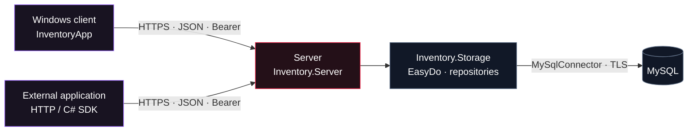

<div align="center">


# STOCKFLOW

**Organize your products. Track your stock. One system for your store and integrations.**


<p><strong>English</strong> &nbsp;|&nbsp; <a href="readme_ru.md">Русский</a></p>
<p><a href="#users">For users</a> &nbsp;·&nbsp; <a href="#developers">For developers</a> &nbsp;·&nbsp; <a href="#easydo">EasyDo in practice</a> &nbsp;·&nbsp; <a href="#api">API</a> &nbsp;·&nbsp; <a href="#roadmap">Roadmap</a> &nbsp;·&nbsp; <a href="docs/PORTFOLIO.md">Portfolio · DE</a></p>

</div>

---

> **DOMAIN: INVENTORY**<br />
> StockFlow is an inventory application for a small store: products, prices, stock receipts, sales and reports. The Windows client and external applications use the same secure server. MySQL stores the data, while reusable **EasyDo** blocks handle repetitive implementation work.

<table>
<tr>
<td width="50%" valign="top">
<h3>I want to use it</h3>
<p>Explore the interface, learn what it does, connect to a server and get started.</p>
<a href="#users"><strong>Open the user guide →</strong></a>
</td>
<td width="50%" valign="top">
<h3>I want to develop it</h3>
<p>Build the project, explore the architecture, integrate the API or add a workflow.</p>
<a href="#developers"><strong>Open the developer guide →</strong></a>
</td>
</tr>
</table>

<a id="users"></a>

## 01 / Your store at a glance

| Area | Available features |
| :--- | :--- |
| **Dashboard** | Daily revenue and profit, receipt count, average sale, a seven-day chart and products that need restocking |
| **Products** | Catalog, search by name/SKU/category, filters, product creation and editing |
| **Stock** | Quantities, minimum levels, availability status, stock receipts, inventory value and price history |
| **Sales** | Checkout with a cart, stock validation, receipts and their line items, sales history by date |
| **Access** | Server login, user roles, action permissions and session revocation |
| **Integrations** | HTTPS API, OpenAPI and a C# client for external applications |

Receipts preserve the product name, price and cost at the time of sale. Editing or deleting a product does not change sales history. Retrying the same sale request does not create a second receipt, and saving a stale product form cannot overwrite newer stock data.

### Interface

<details open>
<summary><strong>Explore the application screens</strong></summary>

| Store dashboard | Product catalog |
| :---: | :---: |
|  |  |
| **Checkout and cart** | **Stock and price history** |
|  |  |

<sub>These screenshots show the original application screens. Version 2.0 adds server login, connection status and logout while preserving the main screen designs. The application interface is in Russian; this README is available in English and Russian.</sub>

</details>

### Download and get started

**[Download v2.0.0 →](https://github.com/TikTak-creator/InventorySystem/releases/tag/v2.0.0)** · [Which file do I need?](docs/RELEASES.md)

The Windows installer includes .NET and adds a Start-menu shortcut. Administrators get a separate server ZIP; developers can download the source ZIP.

1. Install the Windows client from the release page and ask your administrator for the server address and your account.
2. Start `StockFlow.exe` and enter the HTTPS address, such as `https://localhost:7071` for a local server.
3. Enter your username and password. After login, the Dashboard, Products, Sales and Stock sections become available.
4. Use the features allowed by your role. The **«Выйти» (Log out)** button closes the client and attempts to revoke the server session.

Users do not need a MySQL password. The login password and session token are not saved in the client configuration file. To run from source, see the [developer guide](#developers).

| Role | Read data and reports | Products, stock receipts and sales | Delete products | Manage users |
| :--- | :---: | :---: | :---: | :---: |
| **Viewer** | ✓ | — | — | — |
| **Operator** | ✓ | ✓ | — | — |
| **Admin** | ✓ | ✓ | ✓ | ✓ |

<sub>Read access includes purchase costs and profit figures. Access is shared within one store; there is no organization-level separation.</sub>

<details>
<summary><strong>Keyboard shortcuts and common questions</strong></summary>

| Key | Action |
| :--- | :--- |
| `F5` | Refresh the current section |
| `Enter` / double-click | Open a product for editing |
| `Delete` | Delete a product or remove a cart item, depending on the window and permissions |
| `F2` | Complete a sale in the checkout window |

**Cannot log in?** Check the address, server availability, credentials and HTTPS certificate trust. Repeated failed attempts trigger a temporary account lockout.

**Session expired?** Close the client and log in again. There is no default password; your administrator creates your account.

**Product changed while you were editing?** Refresh the list and reopen the product. The server prevents stale forms from overwriting newer data.

**How is profit calculated?** The sum of `quantity × (sale price − cost)` for the receipt items. This figure excludes operating expenses and taxes.

</details>

<a id="developers"></a>

## 02 / Under the hood

### Stack and project boundaries

| Component | Built with | Responsibility |
| :--- | :--- | :--- |
| **InventoryApp** | C# · .NET 8 · WinForms | Windows interface and server login |
| **Inventory.Server** | C# · ASP.NET Core 8 | HTTPS API, login, roles, sessions and rate limits |
| **Inventory.Storage** | C# · MySqlConnector · ADO.NET | Repositories, locks, transactions and MySQL schema |
| **Inventory.Contracts** | C# · .NET 8 | Shared models, DTOs and product rules |
| **Inventory.Client** | C# · HttpClient | Asynchronous SDK for the desktop client and external applications |
| **EasyDo.Core** | C# · .NET standard library | Workflows, validation, SQL parameters and resource lifetimes |
| **EasyDo.WinForms** | C# · WinForms | Controls, typed grids, forms and layout |



Only the server knows the MySQL connection string. The client has no MySQL driver and uses the same API operations as external applications. The server and Core library do not depend on WinForms; the desktop interface runs on Windows.

### Build and run locally

**Requirements:**

- Windows to build and run the full solution with WinForms. The server can be built separately on other platforms supported by .NET.
- **.NET SDK 9.0.200+** for the `.slnx` solution file; the applications target **.NET 8**. With SDK 8, build individual `.csproj` files. [SLNX support](https://devblogs.microsoft.com/dotnet/introducing-slnx-support-dotnet-cli/).
- **ASP.NET Core 8 Runtime** for the server and **.NET Desktop 8 Runtime** for the client.
- **MySQL 8** and a database account for initialization. Restrict the server account's production permissions separately.

Check installed runtimes with `dotnet --list-runtimes` and use current patches. Run the following commands from the repository root.

**1. Build the solution**

```powershell
dotnet restore InventorySystem.slnx
dotnet build InventorySystem.slnx -c Release
dotnet dev-certs https --trust
```

**2. Configure the server and create an administrator**

```powershell
$env:ASPNETCORE_ENVIRONMENT = "Development"
$env:ConnectionStrings__Default = Read-Host "MySQL connection string"
$env:Database__CreateDatabase = "true"

dotnet run --project Inventory.Server -- init-db
dotnet run --project Inventory.Server -- create-user
```

Connection string format: `Server=localhost;Port=3306;Database=inventory_db;User ID=stockflow;Password=<your password>;SslMode=Required;`. Enter it locally. If the database already exists and the account cannot create databases, use `Database__CreateDatabase=false`.

`create-user` prompts for a username, role and password. Choose **Admin** for the first user. There is no shared initial password. Demo data is opt-in through `Database__SeedDemoData=true` and disabled by default.

**3. Start both applications**

```powershell
# Server terminal, with the same environment variables
$env:Database__CreateDatabase = "false"
dotnet run --project Inventory.Server
```

```powershell
# A separate terminal: Windows client
dotnet run --project InventoryApp
```

Enter `https://localhost:7071` and the account you created in the login window.

> [!IMPORTANT]
> This is a local development configuration. A production server requires a trusted HTTPS certificate, secure secret storage and a MySQL connection with `SslMode=VerifyFull`. See [SETUP.md](docs/SETUP.md) for the full instructions.

<details>
<summary><strong>Separate builds, publishing and repository layout</strong></summary>

With .NET SDK 8, build the server and client separately:

```powershell
dotnet build Inventory.Server/Inventory.Server.csproj
dotnet build InventoryApp/InventoryApp.csproj
```

Publish to separate directories:

```powershell
dotnet publish Inventory.Server -c Release -o publish/server
dotnet publish InventoryApp -c Release -r win-x64 --self-contained false -o publish/client
```

```text
InventorySystem/
├── InventoryApp/           # WinForms client
├── Inventory.Server/       # Server and OpenAPI
├── Inventory.Storage/      # SQL, repositories, schema and demo data
├── Inventory.Contracts/    # Models and DTOs
├── Inventory.Client/       # Portable C# SDK
├── EasyDo/                 # Libraries, examples and core tests
├── tests/                  # HTTPS/API integration
├── database/               # SQL for manual deployment
├── docs/                   # Guides, portfolio and artwork
└── scripts/                # OpenAPI generator
```

</details>

<a id="easydo"></a>

## 03 / EasyDo — build it like LEGO

EasyDo removes repetitive implementation work. Store rules remain explicit, while connections, transactions, workflow steps and interfaces are composed from reusable blocks.

```csharp
// Inventory.Storage/SaleRepository.cs
private static readonly Flow<Checkout> SaleRecipe = Flow<Checkout>.Start()
    .Then(LockAndCheckStock)
    .Then(SaveReceipt)
    .Then(SaveItemsAndDeductStock);
```

This pipeline runs **inside one transaction**. An error at any step rolls back both the receipt and the stock deduction.

| Block | Used in |
| :--- | :--- |
| `Flow` | [Sale workflow](Inventory.Storage/SaleRepository.cs) |
| `Store`, `Session`, `Sql` | [Products and transactions](Inventory.Storage/ProductRepository.cs), [user accounts](Inventory.Server/Security/UserStore.cs) |
| `Rules` | [Product validation](Inventory.Contracts/ProductRules.cs) |
| `GridRecipe`, `Matrix`, `UiKit` | [Dashboard grids and layout](InventoryApp/UI/Views/DashboardView.cs) |
| `FormBinding` | [Loading and saving product fields](InventoryApp/UI/Dialogs/ProductEditForm.cs) |
| `ViewDeck` | [Navigation and page lifetimes](InventoryApp/UI/MainForm.cs) |

**Try the same blocks in a different application:**

```powershell
dotnet run --project EasyDo/Examples/TaskBoard
```

TaskBoard is an independent task board with no inventory-specific dependency. [EasyDo guide](EasyDo/README.md) · [Architecture and extension points](EasyDo/ARCHITECTURE.md).

<a id="api"></a>

## 04 / Connect an external application

**24 operations · JSON · OpenAPI 3.0 · HTTPS · revocable Bearer sessions**

The API covers products, categories, stock receipts, sales, price history, reports and user management. The server checks permissions on every request.

```csharp
using Inventory.Client;
using Inventory.Contracts;

using var api = new InventoryApi("https://localhost:7071");
await api.LoginAsync(username, password, cancellationToken);

var products = await api.GetAsync<List<Product>>(
    "api/v1/products?limit=100", cancellationToken);

await api.LogoutAsync(cancellationToken);
```

Reference [Inventory.Client.csproj](Inventory.Client/Inventory.Client.csproj) from your application, or call the operations with a standard HTTP client.

| Document | Contents |
| :--- | :--- |
| [API.md](docs/API.md) | Login, roles, endpoints, limits, errors, C# and PowerShell examples |
| [openapi.json](Inventory.Server/openapi.json) | Machine-readable integration contract |
| [SETUP.md](docs/SETUP.md) | Startup, users, certificates, production and database updates |

> [!NOTE]
> Sales require an `Idempotency-Key`. If the response is lost, retry with **the same key and the same cart**. The server returns the original receipt without deducting stock again. The server determines prices and costs.

## 05 / Security and verification

| Mechanism | Purpose |
| :--- | :--- |
| **HTTPS / TLS 1.2–1.3** | Protects data in transit; the client validates the server certificate |
| **Salted PBKDF2** | Stores passwords as standard IdentityV3 hashes with 600,000 iterations |
| **Random sessions** | Stores only the token's SHA-256 hash in the database; access can be revoked |
| **Server-side roles** | Separate read access, inventory operations and access management |
| **Login protection** | Rate limits requests and temporarily locks accounts after failures |
| **Transactions and locks** | Keep receipts and stock consistent during concurrent sales |
| **Product version checks** | Prevent stale forms from overwriting newer changes |

Database secrets are absent from the client configuration. See [SECURITY.md](docs/SECURITY.md) for protection boundaries, data at rest, certificates and backups.

```powershell
# Core and WinForms
dotnet run --project EasyDo/Tests/EasyDo.Core.Specs
dotnet run --project EasyDo/Tests/StockFlow.Specs

# Real MySQL and HTTPS; temporary test databases only
./EasyDo/Tests/Run-IsolatedMySql.ps1 -IncludeApi
```

Checks cover rollback, concurrent sales, idempotency keys, roles, login lockouts, session expiry and revocation, untrusted certificates and OpenAPI consistency. Unchanged screens have pixel and control-tree comparisons. See the [validation report](docs/VALIDATION.md).

<a id="roadmap"></a>

## 06 / Available now and next steps

**Implemented**

- [x] Product catalog, search, prices, stock receipts and inventory levels.
- [x] Transactional sales, receipt history and store metrics.
- [x] Reusable EasyDo blocks and an independent example application.
- [x] Separate server, HTTPS API and C# SDK.
- [x] Login, roles, password hashing, session revocation and brute-force protection.
- [x] Protection against duplicate sales and stale product updates.
- [x] OpenAPI, setup instructions and integration tests.
- [x] Windows client installer, self-contained server ZIP, source ZIP and release build script.

**Future directions — not implemented yet**

- [ ] Asynchronous WinForms loading with progress and cancellation.
- [ ] Returns, write-offs and a stock movement ledger.
- [ ] Suppliers, purchasing and multiple warehouses.
- [ ] Import/export, additional filters and advanced analytics.
- [ ] Extended audit trail, MFA/SSO and self-service account recovery.
- [ ] CI checks, code signing and automated release publication.

These are development directions, not delivery commitments. The current version serves one store and does not include tax calculation, fiscal compliance or full financial accounting. Synchronous adapters in the current WinForms interface may block the window during network requests.

## 07 / Portfolio and contributions

**[Projektbeschreibung auf Deutsch →](docs/PORTFOLIO.md)** — purpose, architecture, engineering decisions, actual EasyDo use cases and project boundaries.

Git branches preserve the development stages:

| Branch | Contents |
| :--- | :--- |
| [`main`](https://github.com/TikTak-creator/InventorySystem/tree/main) | Original application with direct MySQL access |
| [`redbox/easydo-baseline`](https://github.com/TikTak-creator/InventorySystem/tree/redbox/easydo-baseline) | Preserved version after the EasyDo migration |
| [`redbox/server-api`](https://github.com/TikTak-creator/InventorySystem/tree/redbox/server-api) | Version 2.0: server, client, API and this documentation |

Create contributions from the appropriate branch, describe the scenario and expected behavior, and run the relevant checks. API changes should include updated contracts and documentation. Do not commit passwords, tokens, private keys or production data dumps.

<details>
<summary><strong>About the artwork and documentation languages</strong></summary>

The banner is the project owner's edited version of unofficial **Jujutsu Kaisen** fan art featuring Yuji Itadori, Aoi Todo, Suguru Geto and Satoru Gojo. The palette combines black, crimson and violet. [Banner and artwork history](docs/assets/ART-DIRECTION.md).

This root README is in English; [readme_ru.md](readme_ru.md) contains the Russian edition. Detailed technical guides and the EasyDo documentation are currently in Russian, while the portfolio is in German. Switching the README language does not change the application interface.

</details>

---

<div align="center">
<sub><strong>STOCKFLOW</strong> · Inventory under control · Built with C# &amp; EasyDo</sub><br />
<sub><a href="#users">Get started</a> · <a href="#developers">Explore the code</a> · <a href="docs/API.md">Connect to the API</a></sub>
</div>
