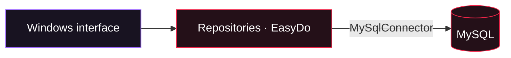

<div align="center">


# STOCKFLOW

**Organize your products. Track your stock. Keep your store in view.**


<p><strong>English</strong> &nbsp;|&nbsp; <a href="readme_ru.md">Русский</a></p>
<p><a href="#users">For users</a> &nbsp;·&nbsp; <a href="#developers">For developers</a> &nbsp;·&nbsp; <a href="#roadmap">Roadmap</a> &nbsp;·&nbsp; <a href="#branches">Choose a version</a></p>

</div>

---

> **DOMAIN: INVENTORY · redbox/easydo-baseline**<br />
> The EasyDo edition of StockFlow: a Windows application for products, prices, stock receipts, sales and reports. Reusable blocks replace repetitive infrastructure code while preserving the original design and store workflows.

> [!NOTE]
> This branch connects the Windows application directly to MySQL. Server login, roles, the HTTPS API and the C# SDK are available in [redbox/server-api](https://github.com/TikTak-creator/InventorySystem/tree/redbox/server-api#readme). The cover represents the project as a whole; the features below describe this branch.

<table>
<tr>
<td width="50%" valign="top"><h3>I want to use it</h3><p>Explore the screens, configure a database and start managing products and sales.</p><a href="#users"><strong>Open the user guide →</strong></a></td>
<td width="50%" valign="top"><h3>I want to develop it</h3><p>Build from source, understand the code and choose the right development branch.</p><a href="#developers"><strong>Open the developer guide →</strong></a></td>
</tr>
</table>

<a id="users"></a>

## 01 / Your store at a glance

| Area | Available features |
| :--- | :--- |
| **Dashboard** | Product count, daily revenue and profit, low-stock items, receipt count, average sale, seven-day revenue chart and recent sales |
| **Products** | Search by name/SKU/category, category and low-stock filters, add/edit/delete products, stock receipts and markup calculation |
| **Sales** | Checkout with a cart, stock checks, transactional receipts, history by date and receipt details |
| **Stock** | Quantities, availability status, inventory value, stock receipts and product price history |

Receipts preserve product names, sale prices and costs at checkout. Changing a price or deleting a product does not rewrite sales history. Price changes are recorded in `price_history`.

### Interface

<details open>
<summary><strong>Explore the application screens</strong></summary>

| Store dashboard | Product catalog |
| :---: | :---: |
|  |  |
| **Checkout and cart** | **Stock and price history** |
|  |  |

<sub>The application interface is in Russian. The README is available in English and Russian. The EasyDo migration preserves the original screen designs.</sub>

</details>

### Start using the application

1. Ask the person deploying the application to configure MySQL as described below.
2. Run `StockFlow.exe` from the published output folder, keeping `appsettings.json` beside it.
3. Use the Dashboard, Products, Sales and Stock sections. This version has no application login or user roles.
4. Add products or use the optional demo data, receive stock and complete a sale through the cart.

| Key | Action |
| :--- | :--- |
| `F5` | Refresh the current section |
| `Enter` / double-click | Edit a product |
| `Delete` | Delete a product or remove a cart item, depending on the window |
| `F2` | Complete a sale in the checkout window |

**Connection error?** Check that MySQL is running, the connection string is correct and the database account has the required permissions. Database initialization runs when the application starts.

**How is profit calculated?** The sum of `quantity × (sale price − cost)` for sold items. It excludes taxes and operating expenses.

<a id="developers"></a>

## 02 / Build and run

**Requirements:** Windows, .NET 8 SDK and MySQL 8. A framework-dependent published application needs .NET Desktop 8 Runtime. The `.slnx` solution requires .NET SDK 9.0.200+; with SDK 8, use the individual project commands below.

**1. Configure a local database**

Edit [InventoryApp/appsettings.json](InventoryApp/appsettings.json) with your local connection details:

```json
{
  "ConnectionStrings": {
    "Default": "Server=localhost;Port=3306;Database=inventory_db;User ID=stockflow;Password=<your-local-password>;CharSet=utf8mb4;"
  },
  "SeedDemoData": false
}
```

The placeholder password must be replaced locally. Database creation and table initialization are automatic; the account needs the corresponding permissions. Set `SeedDemoData` to `true` to populate an empty catalog with 16 example products and a week of sales. SQL for manual deployment is in [database/schema.sql](database/schema.sql).

This branch stores database credentials in a local configuration file and accesses MySQL from the desktop application. Keep real credentials out of commits. For centrally managed access, use the server/API branch.

**2. Build and start from the repository root**

```powershell
dotnet restore InventoryApp/InventoryApp.csproj
dotnet build InventoryApp/InventoryApp.csproj -c Release
dotnet run --project InventoryApp
```

**3. Publish a Windows build**

```powershell
dotnet publish InventoryApp -c Release -r win-x64 --self-contained false -o publish/client
```

### Stack and architecture

| Component | Built with | Responsibility |
| :--- | :--- | :--- |
| **Desktop application** | C# · .NET 8 · WinForms | Russian-language Windows interface, navigation and forms |
| **Data access** | MySqlConnector · ADO.NET | Parameterized SQL, product repositories, receipts and statistics |
| **Database** | MySQL 8 · InnoDB | Products, sales, receipt items and price history |
| **EasyDo** | C# · Core + WinForms | Reusable workflows, validation, SQL, forms and layout |



Sales run in one transaction with `SELECT ... FOR UPDATE` stock locks. A failed sale rolls back its receipt and stock changes. Repeated products are aggregated, stock rows are locked in a consistent order, and checkout reads current database prices.

| Source | Responsibility |
| :--- | :--- |
| [Program.cs](InventoryApp/Program.cs) | Application startup and database initialization |
| [Models](InventoryApp/Models) | Products, sales, cart items and price changes |
| [Database.cs](InventoryApp/Data/Database.cs) | MySQL adapter and initialization |
| [ProductRepository.cs](InventoryApp/Data/ProductRepository.cs) | Catalog, stock receipts and price history |
| [SaleRepository.cs](InventoryApp/Data/SaleRepository.cs) | Transactional checkout and statistics |
| [UI](InventoryApp/UI) | Main window, views, dialogs and appearance |

```text
products ──< sale_items >── sales
    │
    └──< price_history
```

<a id="easydo"></a>

### EasyDo — build it like LEGO

EasyDo extracts reusable workflow, validation, SQL and interface blocks. The Core library is independent of WinForms and the database provider; its WinForms adapter targets Windows. A web or mobile interface would need its own adapter.

```csharp
// InventoryApp/Data/SaleRepository.cs
private static readonly Flow<Checkout> SaleRecipe = Flow<Checkout>.Start()
    .Then(LockAndCheckStock)
    .Then(SaveReceipt)
    .Then(SaveItemsAndDeductStock);
```

`Store.Transaction` runs these steps together. New ideas can reuse resource handling and UI composition while defining their own models, SQL and workflow steps.

| Block | Actual use |
| :--- | :--- |
| `Flow`, `Store`, `Session`, `Sql` | [Sale workflow](InventoryApp/Data/SaleRepository.cs) and [product repository](InventoryApp/Data/ProductRepository.cs) |
| `Rules` | [Product validation](InventoryApp/Models/ProductRules.cs) |
| `UiKit`, `GridRecipe`, `Matrix` | [Dashboard controls and layout](InventoryApp/UI/Views/DashboardView.cs) |
| `FormBinding` | [Product editor](InventoryApp/UI/Dialogs/ProductEditForm.cs) |
| `ViewDeck` | [Page navigation](InventoryApp/UI/MainForm.cs) |

[EasyDo guide](EasyDo/README.md) · [Architecture](EasyDo/ARCHITECTURE.md) · [Independent TaskBoard example](EasyDo/Examples/TaskBoard/Program.cs).

### Verification

```powershell
dotnet run --project EasyDo/Tests/EasyDo.Core.Specs
dotnet run --project EasyDo/Tests/StockFlow.Specs
dotnet run --project EasyDo/Examples/TaskBoard -- --smoke

# Isolated temporary MySQL server; requires a local MySQL installation
./EasyDo/Tests/Run-IsolatedMySql.ps1 -MySqlBase "C:/Program Files/MySQL/MySQL Server 8.4"
```

The [baseline validation report](EasyDo/VALIDATION.md) records 65 checks, including transaction rollback, concurrent sales, schema preservation, eight screen/dialog comparisons and the independent example. The report documents the implementation checks completed on October 13, 2026. Reproduction instructions and test requirements are in the EasyDo guide.


<a id="roadmap"></a>

## 03 / Available now and next steps

- [x] Product catalog, search, prices, stock receipts and inventory levels.
- [x] Transactional sales, receipt history and store metrics.
- [x] Dark Windows interface, charts and keyboard shortcuts.
- [x] Reusable EasyDo blocks, regression checks and an independent TaskBoard example.
- [ ] Asynchronous screen loading and cancellation.
- [ ] Returns, write-offs and a stock movement ledger.
- [ ] Suppliers, purchasing, multiple warehouses and import/export.
- [ ] Full financial accounting and tax/fiscal workflows.

The server, authentication and API are implemented separately in `redbox/server-api`. Synchronous database work can block the interface. This version serves one store and does not include full accounting. Direct quantity editing retains last-save behavior during concurrent edits.

<a id="branches"></a>

## 04 / Choose a version

| Branch | Contents |
| :--- | :--- |
| [main](https://github.com/TikTak-creator/InventorySystem/tree/main) | Original desktop application with direct MySQL access |
| [redbox/easydo-baseline](https://github.com/TikTak-creator/InventorySystem/tree/redbox/easydo-baseline) | EasyDo migration with the original interface and direct MySQL access |
| [redbox/server-api](https://github.com/TikTak-creator/InventorySystem/tree/redbox/server-api) | Separate server and client, HTTPS API, login, roles and C# SDK |

The German portfolio and detailed API/security guides belong to the server version: [Portfolio · DE](https://github.com/TikTak-creator/InventorySystem/blob/redbox/server-api/docs/PORTFOLIO.md) · [API](https://github.com/TikTak-creator/InventorySystem/blob/redbox/server-api/docs/API.md) · [Security](https://github.com/TikTak-creator/InventorySystem/blob/redbox/server-api/docs/SECURITY.md).

For contributions, start from the appropriate branch, describe the intended behavior and include relevant validation. Keep credentials and production data out of commits. The English and Russian root READMEs should describe the same branch behavior.

<details>
<summary><strong>About the artwork and languages</strong></summary>

The banner is the project owner's edited version of unofficial **Jujutsu Kaisen** fan art featuring Yuji Itadori, Aoi Todo, Suguru Geto and Satoru Gojo. [Artwork history](docs/assets/ART-DIRECTION.md).

[README.md](README.md) is the English edition; [readme_ru.md](readme_ru.md) is the Russian edition. Supporting technical guides are currently in Russian, and the portfolio is in German. Switching README language does not change the application interface.

</details>

---

<div align="center">
<sub><strong>STOCKFLOW</strong> · Inventory under control · Built with C# &amp; EasyDo</sub><br />
<sub><a href="#users">Get started</a> · <a href="#developers">Explore the code</a> · <a href="readme_ru.md">Русский</a></sub>
</div>
