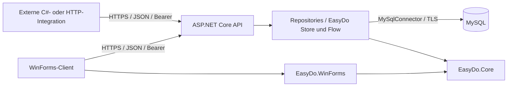

# StockFlow — Client-Server-Warenwirtschaft mit eigener EasyDo-Bibliothek

## Projektüberblick

StockFlow ist eine Warenwirtschaft für einen kleinen Einzelhandelsbetrieb. Die Anwendung verwaltet Artikel, Einkaufspreise, Verkaufspreise, Bestände und Verkäufe. Version 2.0 erweitert die ursprüngliche lokale Desktop-Anwendung um einen separaten HTTPS-Server und eine dokumentierte API für externe Programme.

Der bestehende dunkle WinForms-Aufbau mit Dashboard, Artikelverwaltung, Verkauf und Lager bleibt erhalten. Neu sind die Anmeldung am Server, Benutzerrollen und serverseitige Zugriffskontrollen. Die Bedienoberfläche ist derzeit russisch; diese Dokumentation beschreibt das Projekt für ein deutschsprachiges Portfolio.

## Technischer Aufbau



| Bereich | Umsetzung |
|---|---|
| Sprache und Plattform | C#, .NET 8 |
| Desktop | Windows Forms, eigene Controls und deklarative Layout-Bausteine |
| Server | ASP.NET Core, versionierte HTTPS-JSON-API |
| Datenbank | MySQL, parametrisierte ADO.NET-Abfragen über MySqlConnector |
| Gemeinsame Verträge | Separates Contracts-Projekt mit DTOs |
| Integrationen | Eigenständiger asynchroner C#-Client und OpenAPI 3.0 |
| Tests | Ausführbare Regression-Suites, echtes HTTPS und isolierte MySQL-Datenbanken |

## Zentrale Funktionen

- Artikelkatalog mit Suche, Kategorien und Mindestbeständen.
- Wareneingang, Bestandswert und Historie der Preisänderungen.
- Verkauf mit Warenkorb, Beleg und serverseitiger Bestandsprüfung.
- Dashboard mit Umsatz, Deckungsbeitrag aus Verkaufspreis minus gespeicherten Einstandskosten, letzten Verkäufen und Sieben-Tage-Diagramm.
- Benutzerrollen Viewer, Operator und Admin.
- Dokumentierte API für andere Programme, ohne Weitergabe der Datenbank-Zugangsdaten.

Die ausgewiesene „прибыль“ ist die Summe aus Menge × (Verkaufspreis − Einstandskosten). Betriebskosten, Steuern und weitere Buchhaltungspositionen sind nicht enthalten; das System ist keine vollständige Finanzbuchhaltung oder Fiskalkasse.

## Technische Entscheidungen

**Trennung von Client und Datenzugriff.** Nur der Server kennt die MySQL-Zugangsdaten. Der Desktop-Client und externe Integrationen verwenden dieselben API-Verträge und unterliegen denselben Berechtigungen. Die Storage-Komponente ist unabhängig von WinForms.

**Transaktionaler Verkauf.** Produktzeilen werden mit `SELECT ... FOR UPDATE` in stabiler Reihenfolge gesperrt. Beleg, Positionen und Bestandsabbuchung werden gemeinsam gespeichert. Name, Verkaufspreis und Einstandskosten werden im Beleg eingefroren, sodass spätere Artikeländerungen historische Auswertungen nicht verändern.

**Wiederholbare Verkaufsanfragen.** Ein benutzerspezifischer Idempotency-Key bindet den Request an einen Beleg. Ein identischer Retry liefert denselben Beleg; eine andere Warenkorbzusammensetzung mit demselben Schlüssel führt zu einem Konflikt. Das verhindert doppelte Verkäufe nach einem verlorenen Netzwerk-Response.

**Konflikterkennung bei der Bearbeitung.** Der Client sendet die gelesene Artikelversion zurück. Wenn zwischenzeitlich ein anderer Benutzer oder Verkauf den Datensatz geändert hat, lehnt der Server die veraltete Speicherung ab. Der ursprüngliche Bestandswert einer offenen Maske kann dadurch keinen neueren Bestand überschreiben.

**Nachvollziehbare Sicherheit.** Passwörter werden mit dem standardisierten ASP.NET-Core-Identity-PasswordHasher verarbeitet. Sitzungen verwenden zufällige Tokens, die serverseitig nur als Hash gespeichert werden. HTTPS, Rollen, Login-Limits, zeitweilige Kontosperren und der Widerruf von Sitzungen sind implementiert. Details und Grenzen stehen in [SECURITY.md](SECURITY.md).

## EasyDo im tatsächlichen Projektcode

EasyDo ist eine wiederverwendbare C#-Bibliothek mit zwei Modulen:

- `EasyDo.Core`: Prüfregeln, Workflow-Schritte und sichere Lebensdauer von SQL-Verbindungen/Transaktionen.
- `EasyDo.WinForms`: typisierte Tabellen, Layouts, Formularbindung, Navigation und wiederverwendbare Controls.

Der Verkauf wird im Servercode als explizite Folge zusammengesetzt:

```csharp
private static readonly Flow<Checkout> SaleRecipe = Flow<Checkout>.Start()
    .Then(LockAndCheckStock)
    .Then(SaveReceipt)
    .Then(SaveItemsAndDeductStock);
```

Im Dashboard werden Spalten über Eigenschaften statt Zeichenketten definiert:

```csharp
_recent.Define<Sale>()
    .Column(row => row.Id, "№ чека", 60)
    .Column(row => row.CreatedAt, "Дата и время", 120, "dd.MM.yyyy HH:mm")
    .Column(row => row.ItemsCount, "Товаров", 60, right: true)
    .Column(row => row.Total, "Сумма, сом", 90, "N0", right: true).Apply();
```

`FormBinding` verbindet die Artikelmaske mit dem Modell, `ViewDeck` verwaltet die Navigation und `Store.Transaction` garantiert eine gemeinsame Transaktion. Die separate TaskBoard-Demo verwendet dieselbe Bibliothek ohne Lager- oder Verkaufslogik. [EasyDo-Dokumentation](../EasyDo/README.md).

## Qualitätssicherung und Versionsgeschichte

Die ursprüngliche Version bleibt auf `main` erhalten. `redbox/easydo-baseline` hält die abgeschlossene EasyDo-Umstellung fest; `redbox/server-api` enthält die Client-Server-Erweiterung. Es wurde keine alte Branch-Historie gelöscht.

Regression-Tests prüfen Ressourcenfreigabe, Rollback und Abbruchverhalten. MySQL-Tests prüfen Bestände, Preise, Belege und konkurrierende Verkäufe. HTTPS-Tests prüfen Anmeldung, Berechtigungen, Tokens, Widerruf, Konflikte, Idempotenz und TLS-Validierung. Für unveränderte Arbeitsmasken gibt es einen Vergleich von Control-Baum und gerenderten Pixeln. Die neuen Anmelde- und Statusbereiche werden separat geprüft; sie sind beabsichtigte Änderungen.

Die belegten Ergebnisse und Ausführungsbedingungen stehen in [VALIDATION.md](VALIDATION.md). Die Tests verwenden temporäre Server und Datenbanken; echte Shop-Daten werden nicht benötigt.

## Umfang und Grenzen

Das Projekt bildet einen einzelnen Betrieb mit einer gemeinsamen Datenbank ab. Multi-Tenancy, Mehrlagerlogik, Retouren, Lieferanten, Steuerberechnung, MFA und eine revisionssichere Finanzbuchhaltung gehören nicht zum aktuellen Funktionsumfang. Bestehende WinForms-Listen verwenden synchrone Adapter über dem asynchronen SDK; bei langsamen Verbindungen kann die Oberfläche während des Ladens warten.

Der Server und das Core-Modul lassen sich unabhängig von Windows verwenden; der WinForms-Client bleibt Windows-spezifisch. Eine produktive Installation benötigt verwaltete Zertifikate, Secret-Management, Updates und Backups. Es wird keine abgeschlossene Sicherheitszertifizierung oder ein erfolgreicher Internet-Produktivbetrieb behauptet.

## Weiterführende Dokumentation

[Start und Deployment](SETUP.md) · [API-Vertrag und Beispiele](API.md) · [Sicherheitsmodell](SECURITY.md) · [Validierung](VALIDATION.md)
