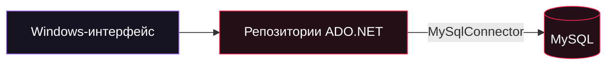

<div align="center">


# STOCKFLOW

**Порядок в товарах. Контроль над остатками. Магазин перед глазами.**


<p><a href="README.md">English</a> &nbsp;|&nbsp; <strong>Русский</strong></p>
<p><a href="#users">Пользователям</a> &nbsp;·&nbsp; <a href="#developers">Разработчикам</a> &nbsp;·&nbsp; <a href="#roadmap">Планы</a> &nbsp;·&nbsp; <a href="#branches">Выбрать версию</a></p>

</div>

---

> **DOMAIN: INVENTORY · main**<br />
> Исходное настольное приложение StockFlow для небольшого магазина: товары, цены, приход, продажи и отчёты. Ветка сохраняет реализацию до EasyDo и разделения на сервер и клиент.

> [!NOTE]
> В этой ветке Windows-приложение подключается к MySQL напрямую. Вход на сервер, роли, HTTPS API и C# SDK доступны в [redbox/server-api](https://github.com/TikTak-creator/InventorySystem/tree/redbox/server-api#readme). Обложка представляет весь проект; возможности ниже относятся к этой ветке.

<table>
<tr>
<td width="50%" valign="top"><h3>Хочу пользоваться</h3><p>Посмотреть экраны, настроить базу и начать работу с товарами и продажами.</p><a href="#users"><strong>Открыть руководство пользователя →</strong></a></td>
<td width="50%" valign="top"><h3>Хочу разрабатывать</h3><p>Собрать проект, изучить код и выбрать подходящую ветку для изменений.</p><a href="#developers"><strong>Открыть руководство разработчика →</strong></a></td>
</tr>
</table>

<a id="users"></a>

## 01 / Магазин под контролем

| Раздел | Что уже работает |
| :--- | :--- |
| **Обзор** | Количество товаров, выручка и прибыль за день, заканчивающиеся товары, количество чеков, средний чек, график выручки за 7 дней и последние продажи |
| **Товары** | Поиск по названию/артикулу/категории, фильтры по категории и остаткам, добавление, редактирование, удаление, приход и расчёт наценки |
| **Продажи** | Касса с корзиной, проверка остатков, транзакционное оформление чека, история за период и состав чека |
| **Склад** | Остатки, статусы наличия, стоимость склада, приход и история цен товара |

Чек сохраняет название, цену продажи и себестоимость на момент оформления. Смена цены или удаление товара не переписывает историю продаж. Изменения цен записываются в `price_history`.

### Интерфейс

<details open>
<summary><strong>Развернуть галерею рабочих экранов</strong></summary>

| Обзор магазина | Каталог товаров |
| :---: | :---: |
|  |  |
| **Касса и корзина** | **Склад и история цен** |
|  |  |

<sub>Интерфейс приложения — на русском. README доступен на русском и английском. Скриншоты показывают исходную версию.</sub>

</details>

### Начать работу

1. Попросите человека, который разворачивает приложение, настроить MySQL по инструкции ниже.
2. Запустите `StockFlow.exe` из папки публикации; рядом должен находиться `appsettings.json`.
3. Откройте разделы «Обзор», «Товары», «Продажи» и «Склад». В этой версии нет входа в приложение и пользовательских ролей.
4. Добавьте товары или включите демо-данные, оформите приход и проведите продажу через корзину.

| Клавиша | Действие |
| :--- | :--- |
| `F5` | Обновить текущий раздел |
| `Enter` / двойной клик | Редактировать товар |
| `Delete` | Удалить товар или убрать позицию из корзины — в зависимости от окна |
| `F2` | Оформить продажу в окне кассы |

**Ошибка подключения?** Проверьте запуск MySQL, строку подключения и права учётной записи БД. Инициализация базы выполняется при старте приложения.

**Откуда берётся прибыль?** Из суммы `количество × (цена продажи − себестоимость)` по проданным позициям. Налоги и операционные расходы в неё не входят.

<a id="developers"></a>

## 02 / Сборка и запуск

**Требования:** Windows, SDK .NET 8 и MySQL 8. Для опубликованной сборки без встроенной среды нужен .NET Desktop 8 Runtime. Решение `.slnx` требует SDK .NET 9.0.200+; с SDK 8 используйте команды для отдельного проекта ниже.

**1. Настройте локальную базу**

Укажите свои локальные параметры в [InventoryApp/appsettings.json](InventoryApp/appsettings.json):

```json
{
  "ConnectionStrings": {
    "Default": "Server=localhost;Port=3306;Database=inventory_db;User ID=stockflow;Password=<ваш-локальный-пароль>;CharSet=utf8mb4;"
  },
  "SeedDemoData": false
}
```

Замените пароль-заглушку локально. База и таблицы создаются автоматически; учётной записи нужны соответствующие права. `SeedDemoData=true` заполняет пустой каталог 16 примерными товарами и продажами за неделю. Скрипт для ручного развёртывания — [database/schema.sql](database/schema.sql).

В этой ветке реквизиты базы хранятся в локальном конфигурационном файле, а настольное приложение обращается к MySQL напрямую. Не добавляйте настоящие пароли в коммиты. Для централизованного доступа используйте серверную ветку.

**2. Соберите и запустите из корня репозитория**

```powershell
dotnet restore InventoryApp/InventoryApp.csproj
dotnet build InventoryApp/InventoryApp.csproj -c Release
dotnet run --project InventoryApp
```

**3. Опубликуйте Windows-сборку**

```powershell
dotnet publish InventoryApp -c Release -r win-x64 --self-contained false -o publish/client
```

### Стек и архитектура

| Компонент | На чём написан | За что отвечает |
| :--- | :--- | :--- |
| **Настольное приложение** | C# · .NET 8 · WinForms | Русский Windows-интерфейс, навигация и формы |
| **Доступ к данным** | MySqlConnector · ADO.NET | Параметризованный SQL, репозитории товаров, чеки и статистика |
| **База данных** | MySQL 8 · InnoDB | Товары, продажи, позиции чеков и история цен |




Продажа выполняется в одной транзакции с блокировками остатков через `SELECT ... FOR UPDATE`. Ошибка продажи откатывает и чек, и изменение остатков.

| Код | Назначение |
| :--- | :--- |
| [Program.cs](InventoryApp/Program.cs) | Запуск приложения и инициализация базы |
| [Models](InventoryApp/Models) | Товары, продажи, корзина и изменения цен |
| [Database.cs](InventoryApp/Data/Database.cs) | Адаптер MySQL и инициализация |
| [ProductRepository.cs](InventoryApp/Data/ProductRepository.cs) | Каталог, приход и история цен |
| [SaleRepository.cs](InventoryApp/Data/SaleRepository.cs) | Транзакционная продажа и статистика |
| [UI](InventoryApp/UI) | Главное окно, разделы, диалоги и оформление |

```text
products ──< sale_items >── sales
    │
    └──< price_history
```

### Проверка

В этой ветке нет автоматизированного набора тестов. После изменений проверьте запуск, редактирование каталога, приход, кассу, историю цен и отчёты на базе разработки.

<a id="roadmap"></a>

## 03 / Что есть и куда развивать

- [x] Каталог, поиск, цены, приход и складские остатки.
- [x] Транзакционные продажи, история чеков и показатели магазина.
- [x] Тёмный Windows-интерфейс, графики и горячие клавиши.

- [ ] Асинхронная загрузка экранов и отмена операций.
- [ ] Возвраты, списания и журнал движения товаров.
- [ ] Поставщики, закупки, несколько складов и импорт/экспорт.
- [ ] Полноценный финансовый учёт и налоговые/фискальные сценарии.

EasyDo реализован в `redbox/easydo-baseline`; сервер, авторизация и API — в `redbox/server-api`. Синхронная работа с БД может блокировать окно. Версия рассчитана на один магазин и не включает полноценную бухгалтерию. Прямое редактирование количества сохраняет поведение последнего сохранения при одновременной правке.

<a id="branches"></a>

## 04 / Выбрать версию

| Ветка | Содержание |
| :--- | :--- |
| [main](https://github.com/TikTak-creator/InventorySystem/tree/main) | Исходное приложение с прямым доступом к MySQL |
| [redbox/easydo-baseline](https://github.com/TikTak-creator/InventorySystem/tree/redbox/easydo-baseline) | Переход на EasyDo с сохранением интерфейса и прямого доступа к MySQL |
| [redbox/server-api](https://github.com/TikTak-creator/InventorySystem/tree/redbox/server-api) | Отдельные сервер и клиент, HTTPS API, вход, роли и C# SDK |

Немецкое портфолио и подробные руководства API/безопасности относятся к серверной версии: [Portfolio · DE](https://github.com/TikTak-creator/InventorySystem/blob/redbox/server-api/docs/PORTFOLIO.md) · [API](https://github.com/TikTak-creator/InventorySystem/blob/redbox/server-api/docs/API.md) · [Безопасность](https://github.com/TikTak-creator/InventorySystem/blob/redbox/server-api/docs/SECURITY.md).

Для вклада создайте ветку от нужной версии, опишите ожидаемое поведение и приложите относящиеся к изменению проверки. Не добавляйте реквизиты доступа и рабочие данные в коммиты. Английский и русский README должны описывать одинаковое поведение ветки.

<details>
<summary><strong>О визуальном оформлении и языках</strong></summary>

Баннер — авторская редакция владельца проекта на основе неофициального фан-арта по **Jujutsu Kaisen**: Юджи Итадори, Аой Тодо, Сугуру Гето и Сатору Годжо. [История оформления](docs/assets/ART-DIRECTION.md).

[README.md](README.md) — английская версия, [readme_ru.md](readme_ru.md) — русская. Подробные технические руководства пока на русском, портфолио — на немецком. Переключение языка README не меняет язык приложения.

</details>

---

<div align="center">
<sub><strong>STOCKFLOW</strong> · Inventory under control · Built with C# &amp; WinForms</sub><br />
<sub><a href="#users">Начать работу</a> · <a href="#developers">Изучить код</a> · <a href="README.md">English</a></sub>
</div>
