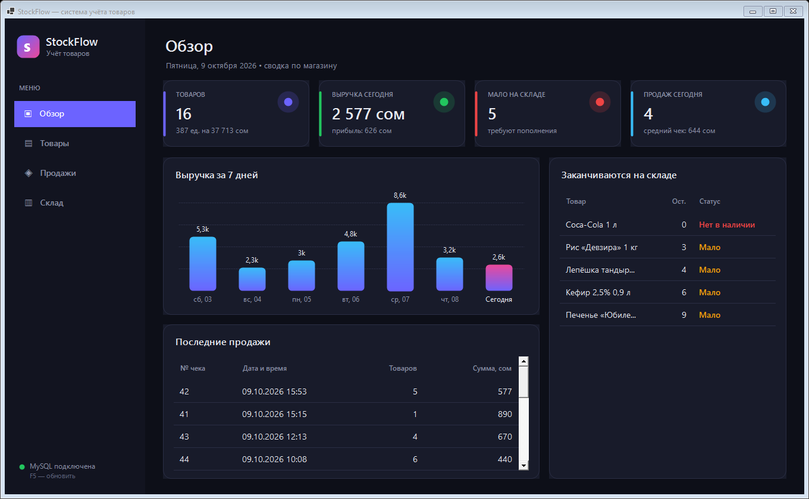
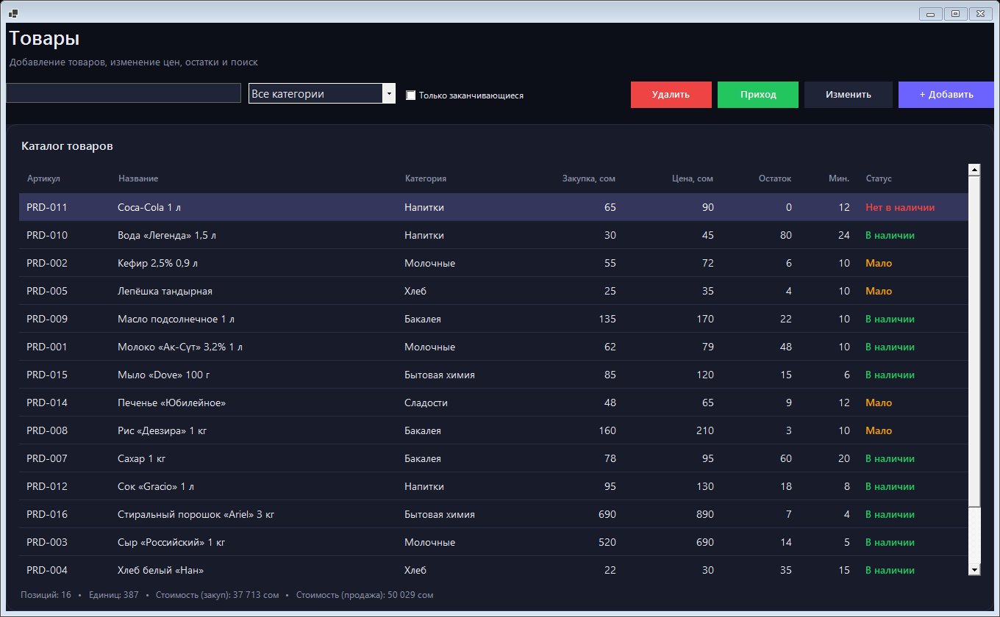
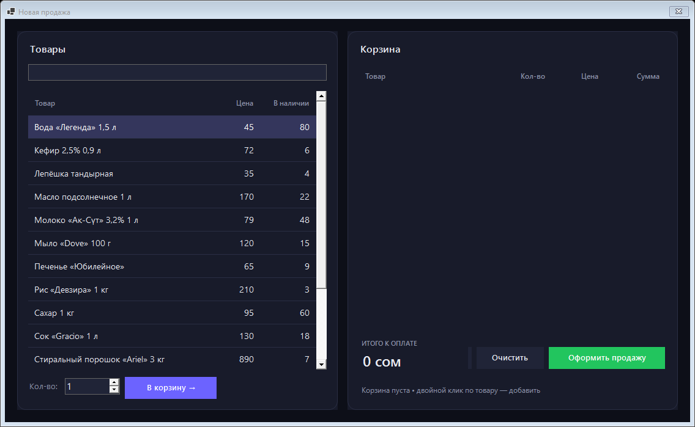
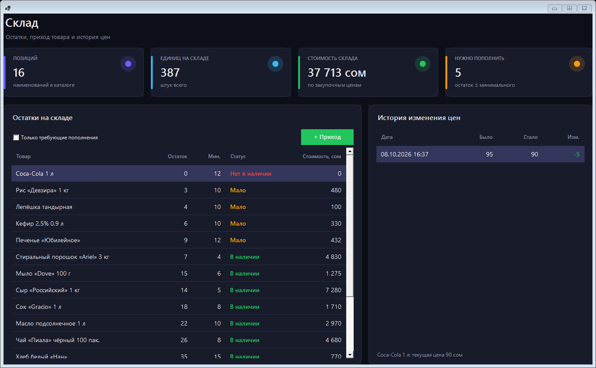
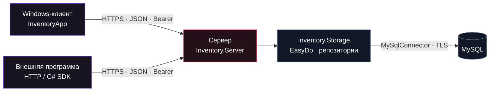

<div align="center">


# STOCKFLOW

**Порядок в товарах. Контроль над остатками. Одна система для магазина и интеграций.**


<p><a href="README.md">English</a> &nbsp;|&nbsp; <strong>Русский</strong></p>

<p><a href="#users">Пользователям</a> &nbsp;·&nbsp; <a href="#developers">Разработчикам</a> &nbsp;·&nbsp; <a href="#easydo">EasyDo в коде</a> &nbsp;·&nbsp; <a href="#api">API</a> &nbsp;·&nbsp; <a href="#roadmap">Планы</a> &nbsp;·&nbsp; <a href="docs/PORTFOLIO.md">Portfolio · DE</a></p>

</div>

---

> **DOMAIN: INVENTORY**<br />
> StockFlow — система учёта для небольшого магазина: товары, цены, приход, продажи и отчёты. Windows-клиент и внешние программы работают через общий защищённый сервер. Данные хранятся в MySQL, а повторяющийся код собирается из собственных блоков **EasyDo**.

<table>
<tr>
<td width="50%" valign="top">
<h3>Хочу пользоваться</h3>
<p>Посмотреть интерфейс, понять возможности, подключиться к серверу и начать работу.</p>
<a href="#users"><strong>Открыть руководство пользователя →</strong></a>
</td>
<td width="50%" valign="top">
<h3>Хочу разрабатывать</h3>
<p>Собрать проект, изучить архитектуру, подключить API или добавить свой сценарий.</p>
<a href="#developers"><strong>Открыть руководство разработчика →</strong></a>
</td>
</tr>
</table>

<a id="users"></a>

## 01 / Магазин под контролем

| Раздел | Что уже работает |
| :--- | :--- |
| **Обзор** | Выручка и прибыль за день, количество чеков, средний чек, график за 7 дней и товары, требующие пополнения |
| **Товары** | Каталог, поиск по названию/артикулу/категории, фильтры, добавление и редактирование |
| **Склад** | Остатки, минимальные пороги, статусы наличия, приход, стоимость склада и история цен |
| **Продажи** | Касса с корзиной, проверка остатков, чек и его состав, история за период |
| **Доступ** | Вход на сервер, роли пользователей, ограничение действий и отзыв сессий |
| **Интеграции** | HTTPS API, OpenAPI и C#-клиент для внешних программ |

Чек сохраняет название, цену и себестоимость на момент продажи. Изменение карточки или удаление товара не меняет историю продаж. Повтор одного запроса продажи не создаёт второй чек, а устаревшая открытая карточка не перезаписывает новый остаток.

### Интерфейс

<details open>
<summary><strong>Развернуть галерею рабочих экранов</strong></summary>

| Обзор магазина | Каталог товаров |
| :---: | :---: |
|  |  |
| **Касса и корзина** | **Склад и история цен** |
|  |  |

<sub>Скриншоты рабочих разделов сохранены из исходной версии. В 2.0 добавлены вход на сервер, статус подключения и выход; основное оформление разделов сохранено. Интерфейс приложения — на русском; README доступен на русском и английском.</sub>

</details>

### Скачать и начать

**[Скачать v2.0.0 →](https://github.com/TikTak-creator/InventorySystem/releases/tag/v2.0.0)** · [Какой файл выбрать?](docs/RELEASES.md#русский)

Windows-установщик уже включает .NET и добавляет ярлык в «Пуск». Для администратора есть отдельный ZIP сервера, для разработчика — ZIP исходников.

1. Установите Windows-клиент со страницы релиза и получите у администратора адрес сервера и свою учётную запись.
2. Запустите `StockFlow.exe` и укажите HTTPS-адрес, например `https://localhost:7071` для локального сервера.
3. Введите логин и пароль. После входа откроются **Обзор**, **Товары**, **Продажи** и **Склад**.
4. Работайте в рамках своей роли. Кнопка **«Выйти»** закрывает клиент и пытается отозвать сессию на сервере.

Пароль MySQL пользователю не нужен. Пароль входа и токен не сохраняются в клиентском конфигурационном файле. Для запуска из исходников — [раздел разработчика](#developers).

| Роль | Читать данные и отчёты | Товары, приход и продажи | Удалять товары | Управлять пользователями |
| :--- | :---: | :---: | :---: | :---: |
| **Viewer** | ✓ | — | — | — |
| **Operator** | ✓ | ✓ | — | — |
| **Admin** | ✓ | ✓ | ✓ | ✓ |

<sub>Чтение включает закупочные цены и показатели прибыли. Это общий доступ одного магазина, без разделения по организациям.</sub>

<details>
<summary><strong>Горячие клавиши и частые вопросы</strong></summary>

| Клавиша | Действие |
| :--- | :--- |
| `F5` | Обновить текущий раздел |
| `Enter` / двойной клик | Открыть товар для редактирования |
| `Delete` | Удалить товар или убрать позицию из корзины — в зависимости от окна и прав |
| `F2` | Оформить продажу в окне кассы |

**Не удаётся войти?** Проверьте адрес и запуск сервера, учётные данные и доверие HTTPS-сертификату. После нескольких неудачных попыток действует временная блокировка.

**Сессия закончилась?** Закройте клиент и войдите заново. Пароль по умолчанию отсутствует; учётную запись выдаёт администратор.

**Товар изменился во время редактирования?** Обновите список и повторно откройте карточку. Сервер защищает более свежие данные от перезаписи.

**Откуда берётся прибыль?** Из суммы `количество × (цена продажи − себестоимость)` по позициям чека. Операционные расходы и налоги в эту величину не входят.

</details>

<a id="developers"></a>

## 02 / Под капотом

### Стек и границы проектов

| Компонент | На чём написан | За что отвечает |
| :--- | :--- | :--- |
| **InventoryApp** | C# · .NET 8 · WinForms | Windows-интерфейс и вход на сервер |
| **Inventory.Server** | C# · ASP.NET Core 8 | HTTPS API, вход, роли, сессии и ограничения запросов |
| **Inventory.Storage** | C# · MySqlConnector · ADO.NET | Репозитории, блокировки, транзакции и схема MySQL |
| **Inventory.Contracts** | C# · .NET 8 | Общие модели, DTO и правила товара |
| **Inventory.Client** | C# · HttpClient | Асинхронный SDK для клиента и внешних программ |
| **EasyDo.Core** | C# · стандартная библиотека .NET | Сценарии, проверки, SQL-параметры и время жизни ресурсов |
| **EasyDo.WinForms** | C# · WinForms | Контролы, типизированные таблицы, формы и компоновка |



Только сервер знает строку подключения к MySQL. Клиент не содержит MySQL-драйвера и обращается к тем же операциям API, что и сторонние программы. Сервер и Core не зависят от WinForms; настольный интерфейс работает на Windows.

### Локальная сборка и запуск

**Подготовьте окружение:**

- Windows — для сборки и запуска полного решения с WinForms; сервер можно собирать отдельно на других поддерживаемых .NET платформах.
- **SDK .NET 9.0.200+** — для файла решения `.slnx`; целевая платформа приложений — **.NET 8**. С SDK 8 собирайте отдельные `.csproj`. [О поддержке SLNX](https://devblogs.microsoft.com/dotnet/introducing-slnx-support-dotnet-cli/).
- **ASP.NET Core 8 Runtime** для сервера и **.NET Desktop 8 Runtime** для клиента.
- **MySQL 8** и учётную запись БД для инициализации. Рабочие права серверной учётной записи ограничиваются отдельно.

Проверьте установленные runtimes: `dotnet --list-runtimes`. Используйте актуальные исправления. Все команды ниже — из корня репозитория.

**1. Соберите проект**

```powershell
dotnet restore InventorySystem.slnx
dotnet build InventorySystem.slnx -c Release
dotnet dev-certs https --trust
```

**2. Настройте сервер и создайте администратора**

```powershell
$env:ASPNETCORE_ENVIRONMENT = "Development"
$env:ConnectionStrings__Default = Read-Host "Строка подключения MySQL"
$env:Database__CreateDatabase = "true"

dotnet run --project Inventory.Server -- init-db
dotnet run --project Inventory.Server -- create-user
```

Форма строки подключения: `Server=localhost;Port=3306;Database=inventory_db;User ID=stockflow;Password=<ваш пароль>;SslMode=Required;`. Введите её локально. Если база уже существует и у учётной записи нет права её создания, используйте `Database__CreateDatabase=false`.

`create-user` спросит логин, роль и пароль; для первого пользователя выберите **Admin**. Общего стартового пароля нет. Демо-данные включаются отдельно через `Database__SeedDemoData=true` и по умолчанию выключены.

**3. Запустите обе части**

```powershell
# Терминал сервера, с теми же переменными окружения
$env:Database__CreateDatabase = "false"
dotnet run --project Inventory.Server
```

```powershell
# Другой терминал: Windows-клиент
dotnet run --project InventoryApp
```

В окне входа укажите `https://localhost:7071` и созданную учётную запись.

> [!IMPORTANT]
> Это конфигурация локальной разработки. Для рабочего сервера нужны доверенный HTTPS-сертификат, защищённое хранение секретов и MySQL-подключение с `SslMode=VerifyFull`. Пошаговая настройка — в [SETUP.md](docs/SETUP.md).

<details>
<summary><strong>Отдельные сборки, публикация и структура репозитория</strong></summary>

С SDK .NET 8 можно собрать сервер и клиент по отдельности:

```powershell
dotnet build Inventory.Server/Inventory.Server.csproj
dotnet build InventoryApp/InventoryApp.csproj
```

Раздельные публикации:

```powershell
dotnet publish Inventory.Server -c Release -o publish/server
dotnet publish InventoryApp -c Release -r win-x64 --self-contained false -o publish/client
```

```text
InventorySystem/
├── InventoryApp/           # WinForms-клиент
├── Inventory.Server/       # Сервер и OpenAPI
├── Inventory.Storage/      # SQL, репозитории, схема и демо
├── Inventory.Contracts/    # Модели и DTO
├── Inventory.Client/       # Переносимый C# SDK
├── EasyDo/                 # Библиотека, примеры и базовые тесты
├── tests/                  # HTTPS/API-интеграция
├── database/               # SQL для ручного развёртывания
├── docs/                   # Руководства, портфолио и графика
└── scripts/                # Генератор OpenAPI
```

</details>

<a id="easydo"></a>

## 03 / EasyDo — собрать как LEGO

EasyDo убирает повторяющуюся техническую работу. Правила магазина остаются явными, а соединения, транзакции, шаги и интерфейс собираются из переиспользуемых блоков.

```csharp
// Inventory.Storage/SaleRepository.cs
private static readonly Flow<Checkout> SaleRecipe = Flow<Checkout>.Start()
    .Then(LockAndCheckStock)
    .Then(SaveReceipt)
    .Then(SaveItemsAndDeductStock);
```

Эта цепочка выполняется **в одной транзакции**. Ошибка на любом шаге откатывает запись чека и списание товара.

| Блок | Где применяется |
| :--- | :--- |
| `Flow` | [Шаги продажи](Inventory.Storage/SaleRepository.cs) |
| `Store`, `Session`, `Sql` | [Товары и транзакции](Inventory.Storage/ProductRepository.cs), [учётные записи](Inventory.Server/Security/UserStore.cs) |
| `Rules` | [Проверки модели товара](Inventory.Contracts/ProductRules.cs) |
| `GridRecipe`, `Matrix`, `UiKit` | [Таблицы и компоновка обзора](InventoryApp/UI/Views/DashboardView.cs) |
| `FormBinding` | [Загрузка и сохранение полей карточки](InventoryApp/UI/Dialogs/ProductEditForm.cs) |
| `ViewDeck` | [Навигация и время жизни страниц](InventoryApp/UI/MainForm.cs) |

**Попробовать другую идею на тех же блоках:**

```powershell
dotnet run --project EasyDo/Examples/TaskBoard
```

TaskBoard — отдельная доска задач без зависимости от складской логики. [Руководство EasyDo](EasyDo/README.md) · [Архитектура и расширение](EasyDo/ARCHITECTURE.md).

<a id="api"></a>

## 04 / Подключить внешнюю программу

**24 операции · JSON · OpenAPI 3.0 · HTTPS · отзываемые Bearer-сессии**

API охватывает товары, категории, приход, продажи, историю цен, отчёты и управление пользователями. Права проверяются сервером на каждом запросе.

```csharp
using Inventory.Client;
using Inventory.Contracts;

using var api = new InventoryApi("https://localhost:7071");
await api.LoginAsync(username, password, cancellationToken);

var products = await api.GetAsync<List<Product>>(
    "api/v1/products?limit=100", cancellationToken);

await api.LogoutAsync(cancellationToken);
```

Для нового клиента подключите [Inventory.Client.csproj](Inventory.Client/Inventory.Client.csproj). Все операции можно вызывать и обычным HTTP-клиентом.

| Документ | Что внутри |
| :--- | :--- |
| [API.md](docs/API.md) | Вход, роли, endpoints, ограничения, ошибки, C# и PowerShell |
| [openapi.json](Inventory.Server/openapi.json) | Машиночитаемый контракт для интеграций |
| [SETUP.md](docs/SETUP.md) | Запуск, пользователи, сертификаты, Production и обновление базы |

> [!NOTE]
> Продажа требует `Idempotency-Key`: при потере ответа повторяйте **тот же ключ и ту же корзину**. Сервер вернёт исходный чек без повторного списания. Цены и себестоимость определяет сервер.

## 05 / Защита и проверяемость

| Механизм | Что делает |
| :--- | :--- |
| **HTTPS / TLS 1.2–1.3** | Защищает передачу; клиент проверяет сертификат сервера |
| **PBKDF2 с солью** | Хранит пароль как стандартный IdentityV3-хэш, 600000 итераций |
| **Случайные сессии** | Токен хранится в БД только как SHA-256-хэш; доступ можно отозвать |
| **Серверные роли** | Разделяют чтение, работу с товарами и управление доступом |
| **Защита входа** | Ограничивает запросы и временно блокирует аккаунт после ошибок |
| **Транзакции и блокировки** | Сохраняют чек и остатки согласованно при конкурентных продажах |
| **Версия карточки** | Не позволяет старой форме перезаписать более свежие изменения |

Секреты базы отсутствуют в конфигурации клиента. Границы защиты, хранение данных на диске, требования к сертификатам и резервным копиям описаны в [SECURITY.md](docs/SECURITY.md).

```powershell
# Ядро и WinForms
dotnet run --project EasyDo/Tests/EasyDo.Core.Specs
dotnet run --project EasyDo/Tests/StockFlow.Specs

# Настоящие MySQL и HTTPS, только временные тестовые базы
./EasyDo/Tests/Run-IsolatedMySql.ps1 -IncludeApi
```

Проверяются откат при ошибке, одновременные продажи, ключи повторов, роли, блокировка входа, истечение и отзыв сессий, недоверенный сертификат и соответствие OpenAPI реальным операциям. Для неизменённых рабочих экранов есть сравнение пикселей и дерева контролов. [Отчёт о проверках](docs/VALIDATION.md).

<a id="roadmap"></a>

## 06 / Что есть и куда развивать

**Реализовано**

- [x] Каталог, поиск, цены, приход и складские остатки.
- [x] Транзакционные продажи, история чеков и показатели магазина.
- [x] Переиспользуемые блоки EasyDo и независимый пример приложения.
- [x] Отдельный сервер, HTTPS API и C# SDK.
- [x] Вход, роли, хэши паролей, отзыв сессий и защита от перебора.
- [x] Защита от повторной продажи и устаревшего сохранения карточки.
- [x] OpenAPI, инструкции запуска и интеграционные тесты.
- [x] Установщик Windows-клиента, ZIP сервера со встроенной .NET, ZIP исходников и скрипт сборки релиза.

**Следующие направления — ещё не реализованы**

- [ ] Асинхронная загрузка WinForms-экранов с состояниями ожидания и отменой.
- [ ] Возвраты, списания и журнал движения товаров.
- [ ] Поставщики, закупки и несколько складов.
- [ ] Импорт/экспорт, дополнительные фильтры и расширенная аналитика.
- [ ] Расширенный аудит действий, MFA/SSO и самостоятельное восстановление доступа.
- [ ] CI-проверки, подпись кода и автоматизированная публикация релизов.

Это направления развития, а не обещание сроков. Текущая версия рассчитана на один магазин; налоги, фискализация и полноценная финансовая бухгалтерия в неё не входят. Синхронные адаптеры текущего WinForms-интерфейса могут блокировать окно на время сетевого запроса.

## 07 / Для портфолио и участников

**[Projektbeschreibung auf Deutsch →](docs/PORTFOLIO.md)** — назначение, архитектура, инженерные решения, реальные сценарии использования EasyDo и границы проекта.

В Git сохранены отдельные этапы:

| Ветка | Содержание |
| :--- | :--- |
| [`main`](https://github.com/TikTak-creator/InventorySystem/tree/main) | Исходное приложение с прямым доступом к MySQL |
| [`redbox/easydo-baseline`](https://github.com/TikTak-creator/InventorySystem/tree/redbox/easydo-baseline) | Сохранённая версия после перехода на EasyDo |
| [`redbox/server-api`](https://github.com/TikTak-creator/InventorySystem/tree/redbox/server-api) | Обновление 2.0: сервер, клиент, API и эта документация |

Для вклада создайте ветку от нужной версии, опишите сценарий и ожидаемое поведение, выполните относящиеся к изменению проверки. Для API-изменений обновите контракт и документацию. Не добавляйте пароли, токены, закрытые ключи или дампы рабочих данных.

<details>
<summary><strong>О визуальном оформлении и языках документации</strong></summary>

Баннер — авторская редакция владельца проекта на основе неофициального фан-арта по **Jujutsu Kaisen**: Юджи Итадори, Аой Тодо, Сугуру Гето и Сатору Годжо. Палитра — чёрный, багровый и фиолетовый; техническая документация и интерфейс приложения оформлены отдельно от этой обложки.

[Баннер и история оформления](docs/assets/ART-DIRECTION.md).

Русская версия находится в `readme_ru.md`, английская — в [README.md](README.md). Подробные технические руководства и документация EasyDo пока на русском, портфолио — на немецком. Переключение языка README не меняет язык приложения.

</details>

---

<div align="center">
<sub><strong>STOCKFLOW</strong> · Inventory under control · Built with C# &amp; EasyDo</sub><br />
<sub><a href="#users">Начать работу</a> · <a href="#developers">Изучить код</a> · <a href="docs/API.md">Подключить API</a></sub>
</div>
